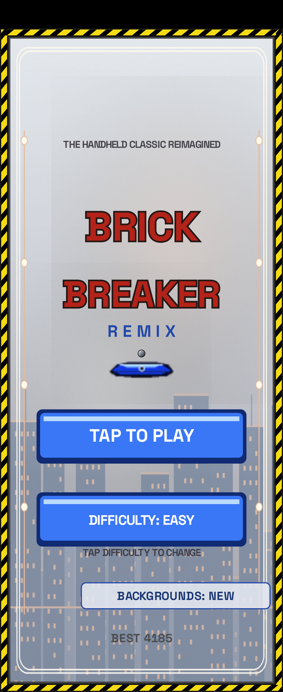
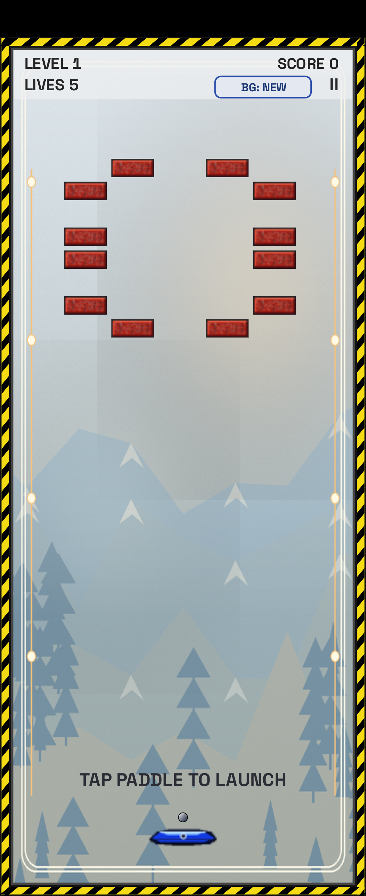

# Brick Breaker Remix

**Brick Breaker Remix** is an unofficial Android recreation of the original BlackBerry BrickBreaker game, combining its classic brick-breaking gameplay and visual style with additional power-ups, customizable difficulty, updated backgrounds, and modern touchscreen controls.

The game includes 34 playable levels based on the original BlackBerry game. Levels 1–5 were recreated from reference screenshots, while levels 6–34 were reconstructed using published walkthroughs and level descriptions.

Developed entirely in Java for Android, the game supports conventional smartphone displays as well as smaller external displays, including the Motorola Razr+ cover screen.

## Features & Gameplay

### Classic BrickBreaker Gameplay
- 34 levels featuring varied brick formations, reinforced bricks, and steel obstacles.
- Paddle-and-ball gameplay with touch controls.
- Score tracking and saved high scores.
- Familiar BlackBerry-inspired graphics, including red bricks, a blue paddle, and hazard-striped borders.
- Separate FIRE control for weapon-based power-ups.
- Multi-ball gameplay and collectible power-up capsules.

### Difficulty Settings

Three difficulty modes adjust paddle response, starting lives, power-up availability, and brick descent.

| Setting | Easy | Normal | Hard |
|---|---|---|---|
| Starting lives | 5 | 3 | 1 |
| Paddle delay | None | 0.25 seconds | 0.5 seconds |
| Power-up drop chance | 20% | 12% | 6% |
| Power-up duration | Indefinite | Standard | Half |
| Descending bricks | Disabled | Standard | Accelerated |

Power-ups have a chance to appear when eligible bricks are hit, replacing the original game's predetermined capsule locations. One-use and ammunition-limited abilities retain their individual restrictions.

### Power-Ups

The game includes 15 power-ups, combining the original BlackBerry abilities with additional mechanics.

**Classic power-ups:**
- **Long:** Increases paddle width.
- **Slow:** Reduces ball speed.
- **Gun:** Provides three shots capable of destroying steel bricks.
- **Laser:** Enables laser fire from the paddle.
- **Multi:** Creates multiple balls.
- **Catch:** Allows the paddle to catch and release the ball.
- **Flip:** Reverses paddle movement.
- **Wrap:** Allows paddle movement across screen boundaries.
- **Bomb:** Arms the ball to damage a brick and surrounding bricks on impact.
- **Life:** Grants an additional life.

**Additional power-ups:**
- **Pierce:** Allows the ball to penetrate bricks.
- **Shield:** Provides one-use protection against losing a ball.
- **Mega:** Releases eight balls simultaneously.
- **Big Ball:** Increases ball size.
- **Magnet:** Adds magnetic ball-control behavior to the paddle.

### Backgrounds & Visuals

Two selectable background modes are available:

- **Classic:** Uses the original-inspired neutral gray masonry appearance.
- **New:** Uses 34 individually themed backgrounds featuring landscapes, cities, underwater environments, architecture, and other illustrated settings.

Background modes can be changed from the title screen or during gameplay. The selected preference is saved between sessions.

All background images are stored as replaceable PNG assets.

### Touchscreen & Display Support
- Touch-based paddle movement.
- Independent paddle and FIRE touch regions.
- Multi-touch support.
- Adaptive playfield scaling for different screen aspect ratios.
- Support for compact displays, including foldable phone cover screens.
- Persistent difficulty and background preferences.

## Version History

### v1.4 — Display, Visual & Power-Up Update
- Redesigned all 34 level backgrounds with illustrated environments.
- Improved scaling for square and compact displays.
- Added layout adjustments for the Motorola Razr+ external screen.
- Corrected playfield positioning to prevent bricks from overlapping the paddle area.
- Added difficulty-dependent power-up durations.
- Improved Bomb power-up behavior with an armed-ball indicator and visible explosion.
- Updated Gun ammunition handling and FIRE button visibility.

### v1.3 — Bundled Level Update
- Added bundled level layouts for stages 6–34.
- Removed the requirement to download additional level data.
- Incorporated reconstructed layouts based on published BlackBerry BrickBreaker walkthroughs.
- Added support for reinforced bricks and steel-brick formations.
- Made all 34 levels available without an internet connection.

### v1.2 — Brick Breaker Remix
- Renamed the game from *Brick Breaker Classic* to *Brick Breaker Remix*.
- Added a persistent Classic/New background toggle.
- Introduced randomized power-up drops.
- Added difficulty-dependent drop probabilities.
- Retained the original-inspired brick layouts while expanding gameplay customization.

### v1.1 — Gameplay Expansion
- Improved touchscreen handling and FIRE button behavior.
- Added independent multi-touch tracking.
- Introduced five additional power-ups: Pierce, Shield, Mega, Big Ball, and Magnet.
- Added difficulty-dependent brick descent.
- Added distinct background artwork for all 34 levels.
- Expanded gameplay effects and power-up interactions.

### v1.0 — Initial Release
- Created the initial Java-based Android recreation of BlackBerry BrickBreaker.
- Reproduced the first five levels using reference screenshots.
- Added 34-level progression with initial replacement layouts for later stages.
- Implemented paddle movement, ball physics, brick collisions, scoring, and lives.
- Added the original ten capsule types.
- Introduced Easy, Normal, and Hard difficulty settings.
- Added a title screen, pause functionality, and saved high scores.
- Established the BlackBerry-inspired visual style and Android build configuration.

  ## Screenshots

  
  

